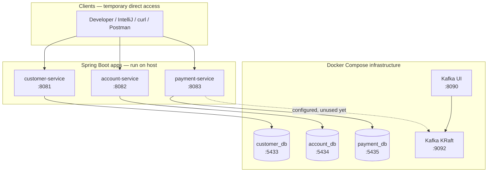
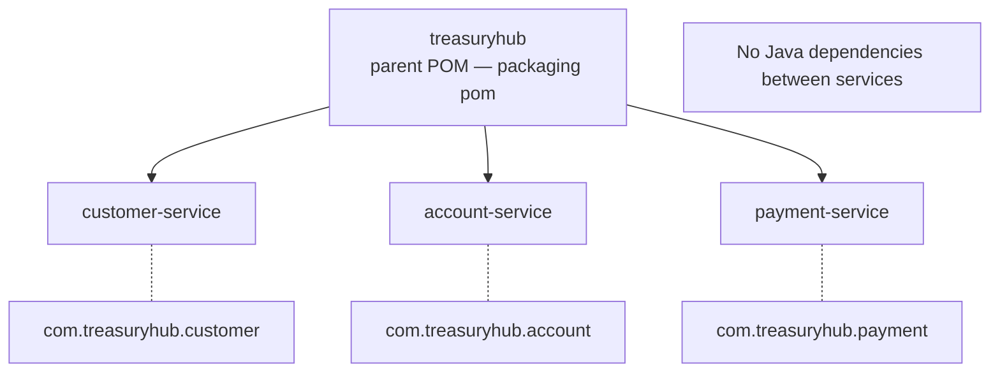
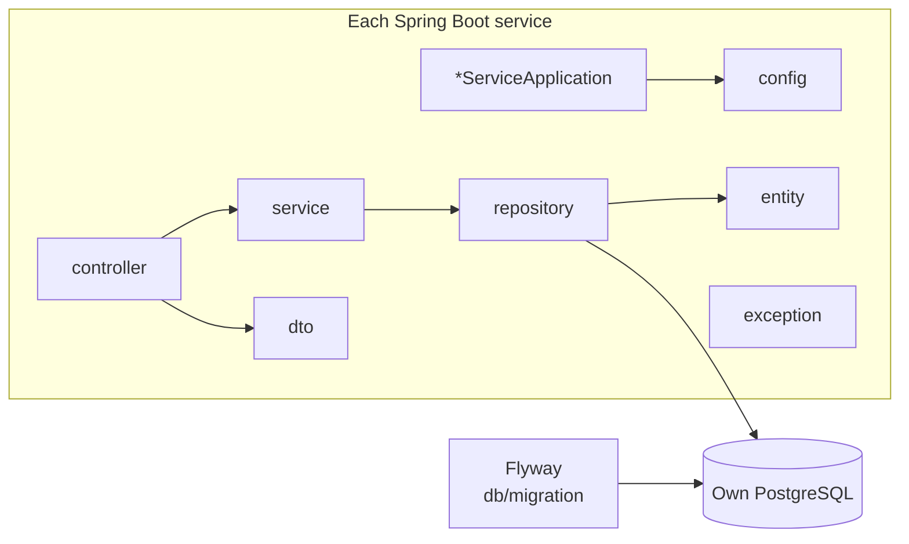
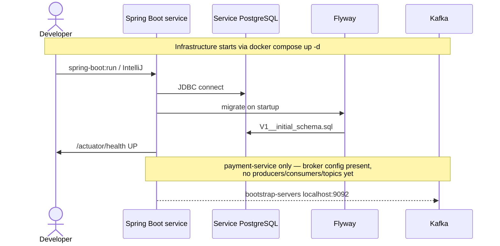
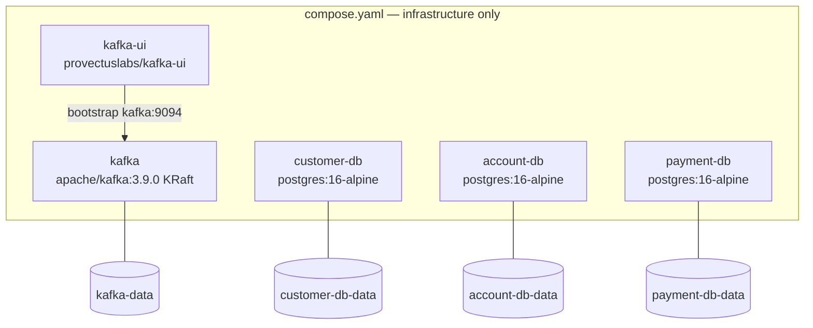
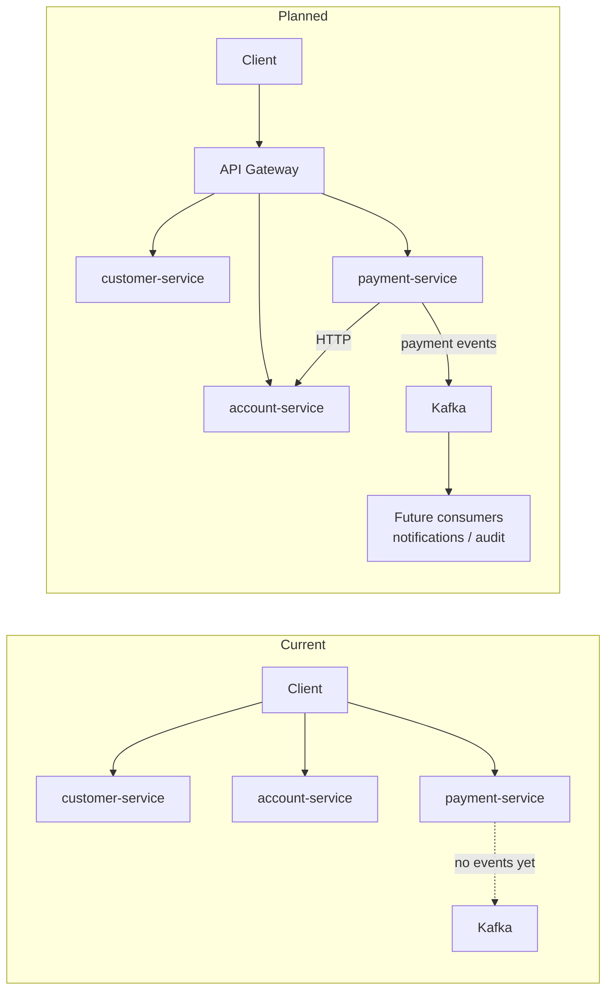
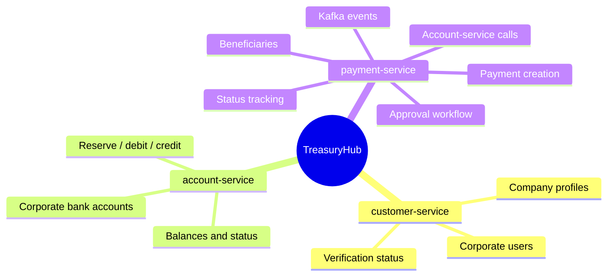

# TreasuryHub — Architecture Diagram

> **Living document.** Update this file whenever services, ports, databases, infrastructure, or communication paths change.
>
> Companion narrative: [architecture.md](./architecture.md)

**Last updated:** 2026-08-03 (local development foundation)

---

## How to maintain this file

When you change the project, update the matching section below:

| Change type | Update |
| --- | --- |
| New / renamed service | System context, ports table, monorepo diagram |
| New database or port | Ports & ownership table, runtime topology |
| New Docker Compose service | Infrastructure diagram, Compose inventory |
| New cross-service API or Kafka topic | Communication diagram (current vs planned) |
| Gateway, security, tracing added | Move items from “Postponed” into active diagrams |
| Business domain features land | Domain responsibilities section |

---

## 1. System context (current)

Temporary local development: clients call each service directly. No API gateway yet.

---

## 2. Ports and ownership

| Component | Host port | Owns / purpose |
| --- | --- | --- |
| customer-service | 8081 | Customer domain HTTP + Actuator |
| account-service | 8082 | Account domain HTTP + Actuator |
| payment-service | 8083 | Payment domain HTTP + Actuator |
| customer-db | 5433 → 5432 | `customer_db` (customer-service only) |
| account-db | 5434 → 5432 | `account_db` (account-service only) |
| payment-db | 5435 → 5432 | `payment_db` (payment-service only) |
| kafka | 9092 | Broker for host apps (`localhost:9092`) |
| kafka (internal) | 9094 | In-compose listener (`kafka:9094`) |
| kafka-ui | 8090 | Topic / message inspection UI |

**Hard rule:** no service may read or write another service’s database.

---

## 3. Maven monorepo layout

Each module is independently runnable and deployable (`spring-boot:run` or its own Dockerfile).

---

## 4. Service internals (shared shape)

All three services follow the same package layout. Payment-service also has `event` and `client` (empty for now).

Schema ownership: Flyway migrations only. Hibernate `ddl-auto: validate`.

---

## 5. Local runtime & data flow

---

## 6. Docker Compose inventory

Application containers are **not** in Compose yet; apps run from the host for easy debugging.

---

## 7. Communication — current vs planned

---

## 8. Domain responsibilities (future business)

Documentation only — not implemented yet.

---

## 9. Intentionally postponed

Keep these **out** of the active diagrams until they are introduced:

- API Gateway
- Service discovery (Eureka, Consul, …)
- Config Server
- Kubernetes
- Spring Security / OAuth
- Distributed tracing
- Resilience libraries
- Redis
- Shared common library

When any of these land, add them to sections 1, 2, 6, and 7 and remove them from this list.

---

## 10. Quick health map

| URL | Expect |
| --- | --- |
| http://localhost:8081/actuator/health | customer-service UP |
| http://localhost:8082/actuator/health | account-service UP |
| http://localhost:8083/actuator/health | payment-service UP |
| http://localhost:8090 | Kafka UI |
