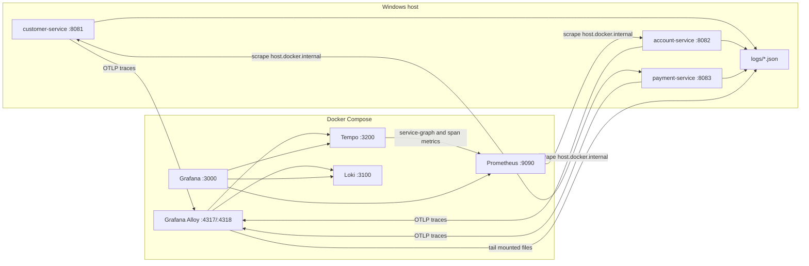

# TreasuryHub local observability

TreasuryHub uses Grafana's existing dashboards and exploration tools; there is no custom observability frontend. Spring Boot applications run on the Windows host, while telemetry infrastructure runs in Docker Compose.

## Data flow



| Component | Responsibility |
| --- | --- |
| Micrometer | HTTP/JVM/Hikari metrics, observations, and Spring trace integration |
| OpenTelemetry | W3C trace context and OTLP trace export |
| Grafana Alloy | Host-facing OTLP receiver, trace forwarding, and log collection |
| Tempo | Trace storage, trace search, and service-graph/span metric generation |
| Prometheus | Application metrics scraping and Tempo-generated metrics storage |
| Loki | Centralized structured-log storage |
| Grafana | Provisioned dashboard and interactive metrics, trace, graph, and log exploration |

Each service has a distinct `service.name` (`customer-service`, `account-service`, or `payment-service`) and the shared `service.namespace=treasuryhub`.

## Start the environment

From the repository root:

```powershell
docker compose up -d
docker compose ps
```

Start all three Spring Boot applications from IntelliJ, or use three terminals:

```powershell
.\mvnw.cmd -pl customer-service spring-boot:run
.\mvnw.cmd -pl account-service spring-boot:run
.\mvnw.cmd -pl payment-service spring-boot:run
```

The default local OTLP endpoint is `http://localhost:4318/v1/traces`. Alloy binds its Docker receiver to `0.0.0.0`, so the published Windows host port works. Prometheus uses `host.docker.internal:8081`, `:8082`, and `:8083`; `localhost` inside its container would point back to Prometheus's own container.

Open Grafana at http://localhost:3000. The local defaults are `admin` / `admin`; set `GRAFANA_ADMIN_USER` and `GRAFANA_ADMIN_PASSWORD` before the first Compose startup to override them.

Use `docker compose down` to stop infrastructure without deleting named volumes. Do not use `docker compose down -v` during routine work.

## Application configuration

The local profile:

- exposes `/actuator/health`, `/actuator/info`, and `/actuator/prometheus`;
- samples 100% of traces by default;
- exports traces to Alloy through OTLP/HTTP;
- emits W3C trace context ready for future instrumented HTTP and Kafka traffic;
- instruments HTTP server requests, selected business methods, and JDBC calls;
- publishes JVM, HTTP, process, and Hikari connection-pool metrics;
- writes ECS JSON logs with `traceId` and `spanId` fields;
- rotates each log at 10 MB, retaining at most seven archives and 100 MB total.

Override sampling without changing source:

```powershell
$env:MANAGEMENT_TRACING_SAMPLING_PROBABILITY = "0.25"
```

Override the collector or log file when needed:

```powershell
$env:OTEL_EXPORTER_OTLP_TRACES_ENDPOINT = "http://localhost:4318/v1/traces"
$env:TREASURYHUB_LOG_FILE = "D:/projects/TreasuryHub/logs/customer-service.json"
```

The default log path is `../logs/<service>.json`, relative to a service module working directory. In IntelliJ, keep the run configuration working directory at the service module, or set `TREASURYHUB_LOG_FILE` explicitly. The repository `logs/` directory is gitignored and mounted read-only into Alloy.

The test profile disables OTLP export, so unit and context tests do not require Alloy or Tempo.

## Generate useful traffic

Health requests generate HTTP traces and metrics:

```powershell
Invoke-RestMethod http://localhost:8081/actuator/health
Invoke-RestMethod http://localhost:8082/actuator/health
Invoke-RestMethod http://localhost:8083/actuator/health
```

Create a sample company to produce an HTTP server span, the `register-company` business span, and JDBC spans:

```powershell
$stamp = [DateTimeOffset]::UtcNow.ToUnixTimeMilliseconds()
$company = Invoke-RestMethod -Method Post `
  -Uri http://localhost:8081/api/v1/companies `
  -ContentType application/json `
  -Body (@{
    legalName = "Observability Demo $stamp"
    registrationNumber = "OBS-$stamp"
    countryCode = "CA"
  } | ConvertTo-Json)
```

Create a sample account using the returned company identifier:

```powershell
Invoke-RestMethod -Method Post `
  -Uri http://localhost:8082/api/v1/accounts `
  -ContentType application/json `
  -Body (@{
    companyId = $company.id
    currencyCode = "CAD"
  } | ConvertTo-Json)
```

These commands insert local development records. They do not create cross-service calls: Account Service stores the supplied company identifier but does not call Customer Service.

## Metrics and dashboard

Open **Dashboards → TreasuryHub → TreasuryHub Overview**. Use the Service selector to view one or all services. The dashboard includes:

- scrape/service health;
- HTTP request rate and 5xx rate;
- p95 and p99 HTTP latency from local histograms;
- JVM memory and process CPU;
- garbage-collection pause rate;
- Hikari active and maximum database connections.

Raw metrics are available at each application's `/actuator/prometheus` endpoint. Prometheus target health is available at http://localhost:9090/targets.

## Traces and waterfall inspection

In Grafana:

1. Open **Explore** and select the **Tempo** data source.
2. Use the Search query type and filter `Service Name` to a TreasuryHub service.
3. Run the query and select a trace.
4. Expand the waterfall to compare the HTTP span, `@Observed` business span, and JDBC spans.
5. Inspect status and duration to find slow or failing work.
6. Use the trace view's logs action to open correlated Loki entries.

JDBC query text is sanitized: bind values are represented by `?`. Request/response bodies, passwords, tokens, customer details, and financial payloads are not deliberately added as span attributes or log messages.

## Service Graph

Tempo's metrics generator writes `service-graphs` and `span-metrics` to Prometheus. In Grafana, open **Explore → Tempo → Service Graph** (the exact menu label can vary slightly by Grafana version), select a time range containing recent traffic, and run the query. Select a node or edge to narrow exploration, then open related traces.

The graph displays only relationships observed in trace traffic. Today it can show:

- an external caller to each service;
- each service to its own PostgreSQL database when JDBC traffic is observed.

It must not show fabricated Customer → Account → Payment edges. No cross-service HTTP calls or Kafka business producers/consumers exist yet. Swagger lists implemented and documented endpoints even when no one calls them; a service graph requires actual instrumented traffic within the selected time range.

## Logs and trace correlation

Open **Explore**, select **Loki**, and query a service:

```logql
{service_name="customer-service"}
```

Structured log records include `traceId` and `spanId` during an observed request. Grafana's Loki derived field makes a log trace ID clickable, and Tempo is configured to search Loki by trace ID and mapped `service.name`/`service_name` labels. Startup lines have no trace ID because they are outside a request span.

If logs are missing:

1. Confirm the three files exist under the repository `logs/` directory.
2. Check `docker compose logs alloy` for file-tail errors.
3. Confirm the Alloy bind mount is `./logs:/var/log/treasuryhub:ro`.
4. Confirm the IntelliJ working directory or `TREASURYHUB_LOG_FILE` points into the repository `logs/` directory.

## Diagnostics

```powershell
docker compose config --quiet
docker compose ps
docker compose logs --tail=100 alloy tempo prometheus loki grafana
Invoke-RestMethod http://localhost:9090/api/v1/targets
Invoke-RestMethod http://localhost:3200/ready
Invoke-RestMethod http://localhost:3100/ready
```

All infrastructure images are pinned in `compose.yaml`. Local retention is seven days for Prometheus and Loki and 24 hours for Tempo traces. Named volumes preserve data across ordinary Compose restarts.

## Current limitations and next steps

- There are no real cross-service HTTP or Kafka business workflows, so no service-to-service graph edges exist yet.
- Kafka observation propagation is enabled in Payment Service configuration, but there are no producers or consumers to exercise it.
- Trace sampling is intentionally 100% for learning locally; lower it for higher-volume environments.
- The stack is a single-node local learning environment, not a highly available production deployment.
- Grafana's default credentials are suitable only for local development.
